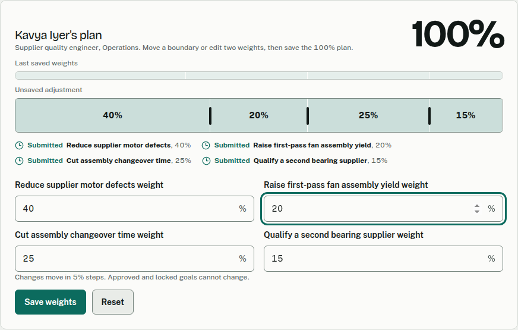
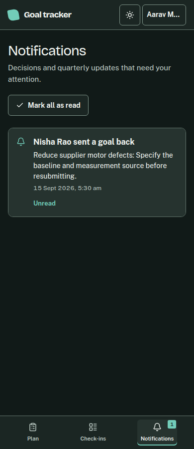

# Goal tracker

Goal tracker is a full-stack workspace for weighted employee goals, manager reviews, quarterly check-ins and HR administration. An employee can submit a plan when its goal weights total exactly 100%. Managers review direct reports; HR administrators manage people, cycles, goal unlocks and the audit trail.

The interface gives each role a focused workspace. Plans show the exact weight and review state; managers work through direct reports; administrators use separate routes for people, hierarchy, cycles, unlocks, and audit history. The public example Plan Bar can be rebalanced without saving.

Managers can transfer weight between submitted or returned goals in 5% steps and save the complete 100% plan in one action. Employees and managers have a Notifications tab with unread counts and links to the relevant plan or check-in. It refreshes on focus and roughly every 30 seconds; notification read state persists across devices.

## Screenshots

Employee plan on desktop:


Employee plan on phone:


Manager review and weight editing:



Reports in dark mode:


Employee notifications:



The [design brief](docs/design-brief.md) explains the Plan Bar, visual tokens, interaction rules, and layout decisions. [Before screenshots](docs/ui/before/) and [after screenshots](docs/ui/after/) show every main route at four widths in both themes. [UI critique](docs/ui/critique.md) records the changes made after screenshot and accessibility review.

## Stack

- Client: React 18, Vite 5, Tailwind CSS 3.4 and Recharts.
- Server: Node.js, Express and Prisma.
- Database: PostgreSQL.
- Sign-in: JWT in an HTTP-only cookie with role checks on protected API routes.

## Run locally

Use Node.js 18.19 or newer and PostgreSQL 14 or newer. Copy `server/.env.example` to `server/.env`, then set `DATABASE_URL` and a development `JWT_SECRET`. Copy `client/.env.example` to `client/.env`; its `/api` base URL uses the Vite development proxy.

```bash
npm install
npm run prisma:generate
npm run prisma:deploy
npm run seed:demo
npm run dev
```

The client runs at `http://localhost:5173` and the API at `http://localhost:4000`. Open `/` for the interactive example or `/login` to sign in. Set `VITE_DEMO_MODE=true` in `client/.env` and restart Vite to make the public role chooser sign in as the seeded demo accounts; leave it false for a regular sign-in link. The interface remembers a manual light/dark choice and otherwise follows the system preference.

Run `npm run prisma:deploy` again after pulling server changes so an existing local database has the latest committed migrations. `npm run seed:demo` uses the existing schema and refuses to run when `NODE_ENV=production`. It upserts a repeatable local fixture with 28 users, 92 goals, quarterly progress and audit history. It is intended for a development database: re-running it restores its owned demo records and marks the current quarter active.

The three primary demo accounts share the development password `Password123!`:

| Role | Email |
| --- | --- |
| Employee | `employee@atomberg.local` |
| Manager | `manager@atomberg.local` |
| HR administrator | `admin@atomberg.local` |

Use `npm run seed` for the original minimal three-user seed. Run `npm run lint` and `npm run build` before committing.

## Documentation

- [Architecture](ARCHITECTURE.md)
- [API routes and filters](API.md)
- [Environment variables](ENVIRONMENT.md)
- [Deployment](DEPLOYMENT.md)
- [Agent guidelines](AGENTS.md)
